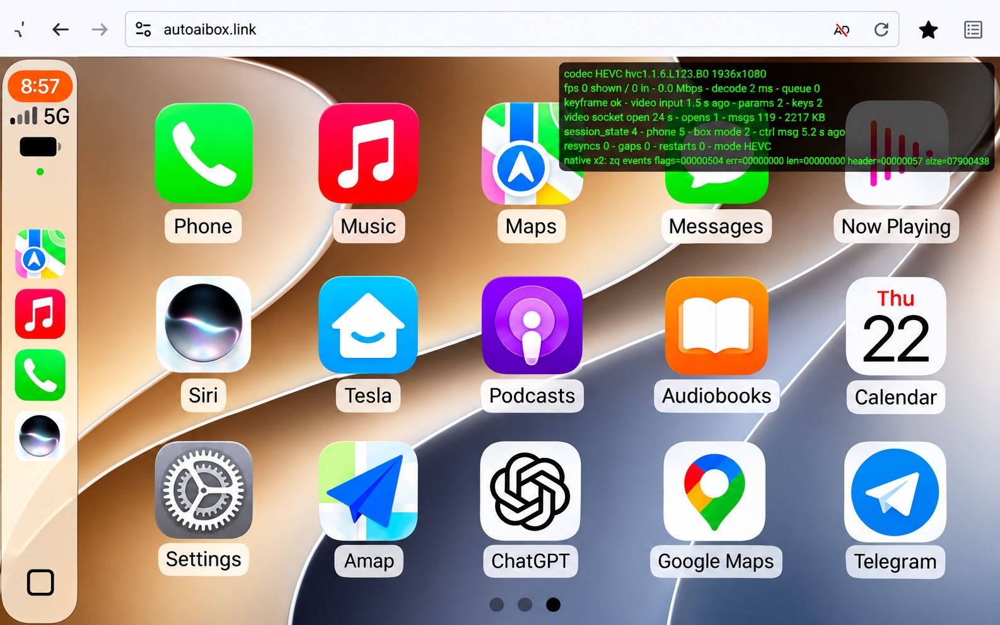

# ownice-tesla-carplay

Community revival of the discontinued **Ownice T3 / zjinnova "T-Box"** wireless CarPlay /
Android Auto adapter for Tesla. The stock firmware shows CarPlay in the Tesla browser as a
re-encoded, upscaled 720p JPEG stream at 30 fps. This project turns it into a
**full-resolution, hardware-decoded H.264 or HEVC stream at up to 60 fps**, with lower
latency, faster encryption, recovery from black screens, and a settings panel in the car.



**Latest release: [2.9.11-oc15](https://github.com/alexcding/ownice-tesla-carplay/releases/tag/2.9.11-oc15)**
for the Ownice T3 on stock **2.9.11 / build 202402031913**. It installs through the
adapter's own web page, no terminal needed.

> Unofficial. Not affiliated with Ownice, zjinnova or Tesla. Flashing modified firmware is at
> your own risk; a rollback package is included.

## Biggest wins

1. **No more JPEG re-encoding.** The phone's own H.264 or HEVC stream goes straight to
   the browser's hardware decoder, at full window resolution and up to 60 fps instead of
   an upscaled 720p JPEG stream at 30 fps. **In an AMD Tesla Model Y: about 60 fps with
   about 2 ms decode at 1080p**.
2. **ChaCha20 stream encryption with our ARM NEON implementation.** The adapter's CPU has
   no AES instructions, so the stock AES-GCM streams were expensive to encrypt. The
   video, control and audio streams now use ChaCha20, running on an ARM NEON routine
   (OpenSSL's, pinned, verified and patched into the receiver) instead of plain C. On the
   adapter the NEON routine needs about half the CPU time of the plain one (1.95×,
   measured), and the owner tested it in use: one of the most noticeable speed-ups of the
   project (hands-on comparison, not a timed end-to-end benchmark).
3. **HEVC in the Tesla browser:** typically a better picture than H.264 at the same Wi-Fi
   bitrate, decoded in hardware (verified in the car).
4. **Lower input and frame latency:** a worker-owned video socket and raw touch events
   keep frames and drags off the page's busy main thread.
5. **It just reconnects:** automatic recovery from black screens, one connection when
   the player opens, and correct full-screen and touch mapping at any resolution.

## Highlights

| | Stock 2.9.11 | This project |
|---|---|---|
| **Video path** | Adapter decodes the phone's H.264 and **re-encodes every frame to JPEG** on its small ARM CPU | **Passthrough**: the phone's own H.264 or **HEVC** goes straight to the browser's hardware decoder (WebCodecs) |
| **Resolution** | Requests 80% of the window, capped at **720p**, then upscales | **Full window size** (Auto, up to 1200 tall), Auto HD up to 1800 tall, or fixed 540p–1440p |
| **Frame rate** | 30 fps requested | **60 fps**: about 60 fps with about 1 ms decode at HiDPI 1080p in an AMD Tesla Model Y (owner report); 50–61 fps measured while moving in Mac Chrome |
| **Codec** | JPEG only in practice | **H.264 or HEVC**, switchable in the car; HEVC verified in the Tesla browser |
| **Frame handling** | Every frame passes through the page's main thread | Video socket and decoding live in a **Web Worker**; frames never touch the main thread |
| **Touch** | Drag moves wait for the next animation frame; hover drags CarPlay with a mouse | **Raw input events** sent as they arrive; repeated points skipped; mouse hover ignored |
| **Stream encryption (TLS)** | AES-256-GCM (Chrome's choice) in plain C on a CPU without AES instructions | Video/control/audio streams use **ChaCha20-Poly1305**, in HEVC builds with **ARM NEON**: about **49% less CPU** for the cipher (measured on the adapter) |
| **Wi-Fi** (opt-in) | Access point starts at 20 MHz, **72 Mbit/s** | **40 MHz, 150 Mbit/s** (measured, macOS client) |
| **Black screens** | Restart CarPlay by hand | Automatic session restart when a running session delivers no video |
| **Opening the player** | Sometimes reconnects the phone | **One connection**: reuses the running session's size |
| **Entry page** | Stays on low-res HTTP from `3.3.3.3` or on tall screens | Always moves to `https://www.zbox.link`, where the HD player works |

## Features

### Video and streaming quality

- **Compressed passthrough instead of JPEG re-encoding.** The stock firmware decoded the
  phone's H.264 on the adapter's Allwinner T113 and re-encoded each frame as JPEG. That
  caused artifacts and latency. The player now asks for H.264 or HEVC passthrough and
  decodes in the browser with WebCodecs, in hardware where available.
- **HEVC (H.265) for CarPlay** (native package). The adapter's receiver is patched to
  advertise HEVC to the iPhone, convert its stream for the browser (VPS/SPS/PPS before
  every keyframe), and pass it through. Verified in Mac Chrome and in the Tesla browser:
  `hvc1.1.6.L123.B0` at 1392×1080, 1–5 ms decode, no gaps or resyncs.
- **Real resolution.** Auto requests the browser window's size at 1× (capped at 1200 tall),
  instead of 80% of a 720p cap. Auto HD and fixed 540p–1440p are available. Keep within
  about 3.7 MP for 50+ fps.
- **60 fps** requested instead of 30. In an AMD Tesla Model Y the owner sees about 60 fps with
  about 1 ms decode at HiDPI 1080p. In Mac Chrome, 54–61 fps was measured with HEVC
  and 50–60 fps with H.264 while moving. An idle CarPlay screen sends only a few frames.
- **Low-latency decoder setup:** `optimizeForLatency` with hardware preferred, and an
  automatic fallback through simpler configurations if the browser refuses one.
- **Smooth playback mode** (optional): a small adaptive jitter buffer (p90 arrival jitter
  + 20 ms, 30–200 ms) for uneven Wi-Fi.
- **Full-screen and side-window layouts:** the picture is fitted and touch-mapped correctly
  after resizing (side window → full screen), at any resolution.

### Latency and touch

- **Worker-owned video socket:** frames go from the network straight to the decoder in a
  Web Worker. The stock path was about one main-thread task per frame; ours is about four
  small notes per second.
- **Raw touch:** drag moves are sent from `pointerrawupdate` as soon as they arrive,
  instead of waiting for Chrome's frame-aligned `touchmove`. Points that map to the same
  CarPlay position are skipped.
- **Quieter hot paths:** no per-move console logging and no per-frame UI update; frame
  buffers are transferred to the worker, not copied.
- **Touch→frame** measured at about 157 ms median (Mac Chrome) with decode at about 2 ms.
  The rest is the phone and adapter round trip. The Video panel measures it live.

### Reliability and recovery

- **Black-screen recovery:** if a running HEVC session's video connection gets nothing for
  8 s, the player restarts the CarPlay session automatically (at most twice per page
  load). The owner reported "no more black screen" in the Tesla.
- **One connection when opening the player:** the adapter restarts the phone session
  (~13 s) whenever the player asks for a different size. The player now reuses the running
  session's size when it opens; only a real resize asks for a new one.
- **Keyframe on reconnect:** the receiver requests a fresh keyframe when a player
  connects, so a reload shows the picture again without a phone reconnect.
- **Lost-frame protection:** H.264 `frame_num` gaps trigger a clean resync instead of a
  smeared picture. Backlog recovery reopens the stream if decoding falls behind.
- **Codec switch without reconnecting:** changing H.264 ↔ HEVC restarts the phone session
  so the new codec takes effect. A browser without an HEVC decoder falls back to H.264
  for that session automatically, without changing your saved choice.
- **Bounded fallbacks:** decoder refusals step through distinct configurations; H.264
  backs off and retries instead of staying black.

### Network and security

- **HTTPS entry fix:** the stock entry page stayed on low-res HTTP when opened from
  `http://3.3.3.3` or on tall screens. It now always moves to `https://www.zbox.link`, the
  only name the adapter's certificate covers.
- **ChaCha20 TLS** (default): the receiver's stream connections (video `:5002`, control
  `:9002`, audio `:7002`) negotiate `TLS_CHACHA20_POLY1305_SHA256` instead of
  AES-256-GCM, which the Cortex-A7 can only do in slow plain C. The receiver's
  statically linked OpenSSL 1.1.1 lists AES first and lets the browser choose (Chrome
  picks AES). Our launcher starts it with `OPENSSL_CONF` → `zq-openssl.cnf`, which lists
  ChaCha20 first with server preference. This was verified on the adapter after a power
  cycle against a client offering AES first. The page itself (`:443`) comes from the
  separate stock web server and keeps its own TLS, so the browser's padlock shows AES;
  check a `:5002` WebSocket in DevTools instead. The owner described the result as
  "a lot faster" (subjective).
- **NEON-accelerated ChaCha20** in every HEVC build: OpenSSL's ARM NEON routine, pinned
  and verified, patched into the receiver. On the adapter it used about **49% less CPU
  time** for the cipher (1.95×) and ran 1.90× faster in wall time. That measures the
  cipher alone, not end-to-end streaming.
- **40 MHz Wi-Fi** (opt-in `--wifi-ht40`): the access point's driver starts at 20 MHz;
  the boot script widens it to 40 MHz on a fixed channel. Measured 72 → **150 Mbit/s**,
  with a fallback after two failed boots. 802.11ac 80 MHz is available as an untested
  experiment (`--wifi-ac`).

### In-car settings and diagnostics

A **Video** button (camera icon) next to the player's settings button opens a panel:

| Setting | Options |
|---|---|
| Resolution | Auto (screen), Auto HD, 540p, 720p, 900p, 1080p, 1440p |
| Frame rate | 30, 60 |
| Video | HEVC (HD), H.264 (HD), JPEG (compatible) |
| Playback | Low latency, Smooth |
| Video socket | Worker (fast), Page (stock) |
| Touch | Raw (fast), Stock |
| Debug overlay | Off, On |

The panel also shows live stream stats: codec, size, fps shown/received, decode time,
queue, bitrate and bits per pixel, resyncs and frame gaps. It shows touch input delay,
touch→frame latency, the adapter's Wi-Fi channel, and a **Decoder** line: which hardware
and software decoders the browser supports, and which configuration is running. The
**debug overlay** adds session state, video-socket counters, automatic restarts and the
native receiver's converter reports.

### Safe updates

- **Strict patching:** every change is an exact string or instruction replacement with an
  expected match count, against MD5- and SHA-256-pinned stock files. A different base
  fails the build instead of guessing.
- **Rollback:** native installs back up the stock receiver files first. The restore
  package checks backups and manifests before replacing anything.
- **Build identity:** packages carry `zq-build.txt` (version + content hash + options).
  `tools/flash.sh` waits for exactly that build.
- **No vendor secrets:** the stock archive and its private TLS keys are never committed
  or published; patches are applied at build time.

## Download and install

1. Download **`update_tesla_hevc_2.9.11-oc15.zip`** from the
   [release](https://github.com/alexcding/ownice-tesla-carplay/releases/tag/2.9.11-oc15).
   Leave it zipped.
2. Connect to the adapter's Wi-Fi and open **http://3.3.3.3**.
3. Upload the ZIP with the normal firmware update option, and wait until it finishes.
   Don't cut power while it installs.
4. **Power-cycle the adapter**, then reconnect the phone.
5. In the Tesla browser, open **https://www.zbox.link**. In **Video**, choose HEVC or
   H.264 and **Apply & reload**.

Supported base: **Ownice T3 stock 2.9.11 / build 202402031913**. Older firmware (such as
2.9.2) and other models are unverified; update to the official 2.9.11 first. Keep only one
player window connected at a time.

**Partial fix without flashing:** in the Tesla browser on the adapter's Wi-Fi, open exactly
`https://www.zbox.link` and bookmark it. That avoids the stock entry page's HTTP
fallback, but the stock player still uses its JPEG path; passthrough, HEVC and the
other features need the update.

**Roll back:** upload `restore_native_2.9.11-oc15.zip` the same way and power-cycle. For a
complete stock reinstall, use the official
[vendor 2.9.11 ZIP](https://cdn.zjinnova.com/tesla/en/update_tesla0817.zip) (MD5
`3a743be56b60df524825cffcf45238cd`; keep a private copy and don't rehost it, as it
contains private keys) or `tools/flash.sh rollback`. See
[native rollback](docs/NATIVE_ROLLBACK.md).

## Known limits

- **First open after another device used the adapter:** one session restart (~15 s) may
  happen while it learns your window size.
- **Very high resolutions cost frame rate:** 2912×1440 gave about 30 fps against 55–60 at
  window size. **Auto** is recommended for the smoothest picture.
- **Changing to or from JPEG** still needs the phone disconnected before Apply, then a
  reconnect.
- Still being validated: long idle/return in the car, the in-car codec switch, 802.11ac.
  Android Auto has no HEVC path. See the
  [HEVC diagnostic record](docs/HEVC_VIDEO_DIAGNOSTICS.md).

## Build from source

The builder downloads the pinned official archive (or takes `--firmware stock.zip`),
verifies it, and applies the patches.

```sh
# browser player + HTTPS fix + ChaCha20 TLS
python3 -I tools/build_patch.py --out build/update_tesla.zip

# complete HEVC package (as released): native receiver + NEON + browser files
python3 -m venv build/crypto-env
build/crypto-env/bin/pip install -r tools/requirements-crypto-neon.txt
build/crypto-env/bin/python -I tools/build_patch.py --native-hevc --native-video-diag \
  --keep-compressed-video-focus --out build/update_tesla_hevc_2.9.11-oc15.zip

# native rollback package
python3 -I tools/build_patch.py --restore-native --out build/restore_native.zip
```

Native builds need an ARM-capable Clang/LLD (LLVM 22); see
[the native path](docs/CARPLAY_HEVC_NATIVE_PATH.md) and
[crypto release instructions](docs/CRYPTO_RELEASES.md). Browser-only packages leave an
installed native receiver (and its NEON optimization) untouched. `--native-only` is only
for intentionally keeping the installed player files. Wi-Fi options: `--wifi-ht40`,
`--wifi-ac`, `--wifi-diag`. Every package is versioned plain `2.9.11-ocN`; options are
recorded in its `zq-build.txt`.

Flash a build over the adapter's web API, then power-cycle:

```sh
tools/flash.sh update build/update_tesla_hevc_2.9.11-oc15.zip
tools/flash.sh status
```

## Development

Test player changes against a live adapter without flashing. A local HTTPS proxy serves
the patched player and `player/*.js` from disk:

```sh
python3 -I tools/dev_player.py --firmware build/stock_2.9.11.zip   # prints the Chrome command
```

To view the adapter's own player on a Mac (`www.zbox.link` must resolve to `3.3.3.3`):

```sh
open -na "Google Chrome" --args --user-data-dir=/tmp/zbox-chrome --no-proxy-server \
  --host-resolver-rules="MAP www.zbox.link 3.3.3.3" https://www.zbox.link/
```

| Script | Purpose |
|---|---|
| `tools/build_patch.py` | build update / native / restore packages |
| `tools/flash.sh` | `status`, `update [zip]`, `rollback [zip]` over the web UI |
| `tools/dev_player.py` | live HTTPS proxy for player development |
| `tools/box_info.sh` | read-only status: version, channel, Wi-Fi, certificate expiry |
| `player/worker.js` | video worker: WebCodecs H.264/HEVC, JPEG fallback, socket, recovery |
| `player/zq-settings.js` | in-car settings panel, stats, session-size and recovery logic |

**Documentation:** [HEVC diagnostics](docs/HEVC_VIDEO_DIAGNOSTICS.md) ·
[HEVC research](docs/HEVC_RESEARCH.md) ·
[codec switching](docs/CODEC_SWITCH_DESIGN.md) ·
[reconnect recovery](docs/HEVC_RECONNECT_FIX.md) ·
[crypto research](docs/CRYPTO_RESEARCH.md) ·
[firmware improvement survey](docs/FIRMWARE_IMPROVEMENTS.md) ·
[receiver candidates](docs/RECEIVER_CANDIDATES.md) ·
[device reference](docs/DEVICE_REFERENCE.md) ·
[contribution rules](AGENTS.md)

## License

MIT. Covers the code in this repository only, not the vendor firmware.
